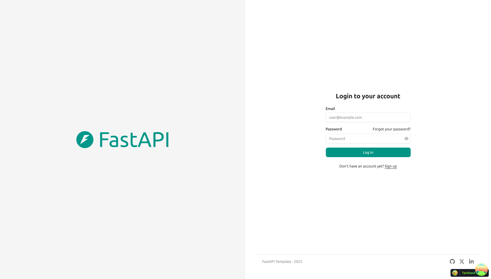

# Full Stack FastAPI Template

[](../../actions/workflows/test-docker-compose.yml)
[](../../actions/workflows/test-backend.yml)

## Technology Stack and Features

- ⚡ [**FastAPI**](https://fastapi.tiangolo.com) for the Python backend API.
  - 🧰 [SQLModel](https://sqlmodel.tiangolo.com) for the Python SQL database interactions (ORM).
  - 🔍 [Pydantic](https://docs.pydantic.dev), used by FastAPI, for the data validation and settings management.
  - 💾 [PostgreSQL](https://www.postgresql.org) as the SQL database.
- 🚀 [React](https://react.dev) for the frontend.
  - 🧩 Built into the backend application and served by FastAPI on the same domain as the API.
  - 💃 Using TypeScript, hooks, [Vite](https://vitejs.dev), and other parts of a modern frontend stack.
  - 🎨 [Tailwind CSS](https://tailwindcss.com) and [shadcn/ui](https://ui.shadcn.com) for the frontend components.
  - 🤖 An automatically generated frontend client.
  - 🧪 [Playwright](https://playwright.dev) for end-to-end testing.
  - 🦇 Dark mode support.
- ☁️ [FastAPI Cloud](https://fastapicloud.com) for deployment.
- 🐋 [Docker Compose](https://www.docker.com) for local services and self-hosted deployment.
  - 📞 [Traefik](https://traefik.io) as a reverse proxy with automatic HTTPS.
- 🔒 Secure password hashing by default.
- 🔑 JWT (JSON Web Token) authentication.
- 📫 Email-based password recovery.
- 📬 [Mailpit](https://mailpit.axllent.org) for local email testing during development.
- ✅ Tests with [Pytest](https://pytest.org).
- 🏭 CI (continuous integration) and CD (continuous deployment) based on GitHub Actions.

### Dashboard Login



### Dashboard - Admin


### Dashboard - Items


### Dashboard - Dark Mode


### Interactive API Documentation


## How to Use It

Click the **Use this template** button at the top of this page to create a new repository.

## Backend Development

Backend docs: [backend/README.md](./backend/README.md).

## Frontend Development

Frontend docs: [frontend/README.md](./frontend/README.md).

## Deployment

FastAPI Cloud deployment: [deployment.md](./deployment.md).

Self-hosted deployment with Docker Compose: [deployment-docker-compose.md](./deployment-docker-compose.md).

## Development

General development docs: [development.md](./development.md).

This includes the local FastAPI and Vite workflow, Docker Compose services, `.env` configuration, and more.

## RBAC Setup

1. Start infrastructure and install dependencies:

```bash
docker compose up -d db mailpit
cd backend
uv sync
```

2. Apply database migrations:

```bash
uv run alembic upgrade head
```

3. Seed initial data, including one user per role (`admin`, `manager`, `member`):

```bash
uv run python -m app.initial_data
```

4. Run the backend and frontend:

```bash
# terminal 1
cd backend
uv run fastapi dev

# terminal 2
cd frontend
bun install
bun run dev
```

## RBAC Permission Matrix

| Action | Admin | Manager | Member |
|---|---|---|---|
| List users (`GET /api/v1/users/`) | Allow | Deny (403) | Deny (403) |
| Create user (`POST /api/v1/users/`) | Allow | Deny (403) | Deny (403) |
| Update user (`PATCH /api/v1/users/{user_id}`) | Allow | Deny (403) | Deny (403) |
| Delete user (`DELETE /api/v1/users/{user_id}`) | Allow | Deny (403) | Deny (403) |
| Read own user by id (`GET /api/v1/users/{user_id}` self) | Allow | Allow | Allow |
| Read other user by id (`GET /api/v1/users/{user_id}` non-self) | Allow | Deny (403) | Deny (403) |
| Self-service endpoints (`/users/me`, `/users/me/password`, `/users/me` delete) | Allow | Allow | Allow |
| Metrics API (`GET /api/v1/metrics/`) | Allow | Allow | Deny (403) |
| Users page/link (`/admin`) | Allow | Hidden + Deny | Hidden + Deny |
| Metrics page/link (`/metrics`) | Allow | Allow | Hidden + Deny |

## RBAC Architecture Summary

The backend uses FastAPI dependency injection for authorization so access checks stay close to route definitions and remain easy to audit. A reusable role-check dependency (`require_roles`) accepts allowed roles and consistently returns a `403 Forbidden` response when a role is not permitted. This keeps authorization logic declarative and avoids repeating conditional blocks in every endpoint.

Roles are modeled on the `User` SQLModel as an enum (`admin`, `manager`, `member`) with a default of `member`. This keeps role semantics explicit in the schema and avoids hidden behavior based on ad hoc booleans. Existing `is_superuser` is preserved for compatibility, while RBAC decisions for users and metrics routes are role-based.

On the frontend, role awareness is pulled from the authenticated user payload. Navigation visibility is controlled using role checks, and protected routes validate access during route loading. Unauthorized direct navigation is redirected to a dedicated `403 Access Denied` page so failures are explicit and user-friendly.

The frontend also separates authentication failures from authorization failures: `401` responses still trigger logout, while `403` responses no longer force logout globally. This preserves session state and enables clear forbidden-state UX for authenticated users lacking permission.

## ADR: RBAC vs ABAC

This implementation intentionally chooses RBAC over ABAC to optimize for readability, delivery speed, and maintenance in a small codebase. A simple role enum and dependency-based route guards are enough to model current requirements without introducing policy engines, resource attributes, or dynamic rule evaluation.

ABAC would provide finer-grained control for future scenarios (for example, department-scoped ownership or time-based permissions), but it would increase cognitive load and test surface area now. Given current requirements, RBAC provides the best trade-off between correctness and simplicity while leaving room to evolve later if policy complexity grows.

## Release Notes

Check the file [release-notes.md](./release-notes.md).

## License

The Full Stack FastAPI Template is licensed under the terms of the MIT license.
